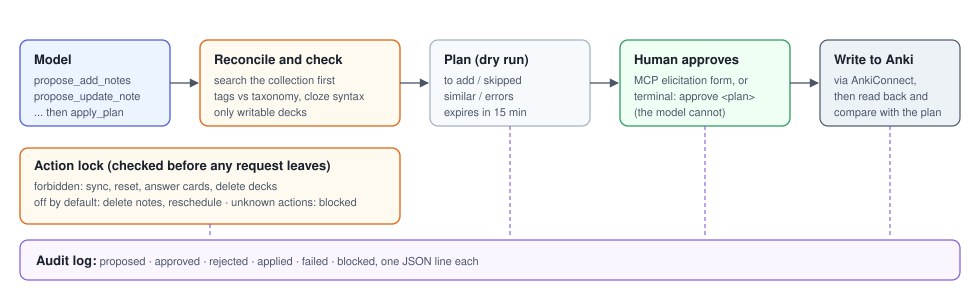

# anki-librarian-mcp

An MCP server that lets a model work with your Anki collection through a locked door: reads are free, every
write is a dry-run plan that a human approves before anything reaches Anki.


## Results

| Result | Source in this repo |
|---|---|
| One session against the real server process: a plan rejected for a bad tag, a duplicate skipped, a similar front flagged (0.92), a write approved by the human and read back, a delete blocked | `python demo.py` · [`examples/demo_transcript.md`](examples/demo_transcript.md) |
| Delete and reschedule are off by default; sync, card resets and deck deletion never leave the server | [`src/anki_librarian_mcp/connect.py`](src/anki_librarian_mcp/connect.py) · [`tests/test_connect.py`](tests/test_connect.py) |
| 44 tests on a fake AnkiConnect (in memory and over HTTP) plus a full MCP client session; no Anki needed | [`tests/`](tests/) |
| No test, demo or CI run ever writes to a real collection | [`tests/fake_anki.py`](tests/fake_anki.py) |



## Run it

```
pip install -r requirements.txt
python demo.py
```

It starts a fake AnkiConnect, launches the server over stdio as Claude Code or Claude Desktop would, and plays
one session (the human's click is simulated):

```
user   > (illustrative) add these 3 cards on the Taylor rule to Economics::Macro (+1 on Okun's law)
model  > find_notes("taylor")               -> 1 note: "What does the Taylor rule set?"
model  > propose_add_notes(4 notes)         -> status invalid
           note 4: tag 'economics::macro': unknown root 'economics' (did you mean Economics?)
model  > propose_add_notes(3 notes)         -> status pending, nothing written yet
           to add: 2 · skipped as duplicate: 1 (note 1700000000000)
           similar flagged: "What does the Taylor rule target?" ~ existing front (0.92)
model  > apply_plan(p-...)
server -> asks the HUMAN (elicitation form, not the model):
           Add 2 note(s) to 'Economics::Macro'
             + What does the Taylor rule target?
             + Taylor principle
           Skipped as duplicates: 1 · Similar to existing notes: 1 (check before approving)
           Write this to Anki?                                    [approve]
server -> applied: created 2, mismatched after write 0 (read back from Anki)
model  > propose_delete_notes([...])        -> BLOCKED: deleteNotes is off. Turning it on is the
                                               human's decision (allow_delete = true in the config).
audit  : proposed (invalid) · proposed · approved via mcp elicitation · applied · blocked
```

To use it with your own Anki you need Anki desktop with the [AnkiConnect](https://ankiweb.net/shared/info/2055492159) add-on:

```
pip install git+https://github.com/gcabralcavalcanti/anki-librarian-mcp
cp anki-librarian.example.toml anki-librarian.toml     # then list your writable decks and taxonomy
anki-librarian-mcp check                                 # shows the settings and pings AnkiConnect
```

Ready-made client configs are in [`examples/config/`](examples/config/):

| Client | File | Where it goes |
|---|---|---|
| Claude Code (project) | [`.mcp.json`](examples/config/.mcp.json) | project root; or run `claude mcp add anki -- anki-librarian-mcp --config anki-librarian.toml serve` |
| Claude Desktop | [`claude_desktop_config.json`](examples/config/claude_desktop_config.json) | Settings > Developer > Edit Config; merge the `mcpServers` entry |
| Either, from a source checkout | [`claude_desktop_config.from_source.json`](examples/config/claude_desktop_config.from_source.json) | same, without installing the package |

Restart the client; the tools appear as `anki`. Start with an empty `writable_decks` list (read-only) and add a
test deck before your real ones.

## How it works

1. **Propose.** Every write tool (`propose_*`) returns a plan and writes nothing. Before building it the server
   searches the collection: an exact duplicate is skipped, "same front, different back" is left for the human,
   and a front that is merely similar (default 85%) is flagged in the preview. Tags are checked against your
   taxonomy, cloze syntax against the whole batch, and every target deck against the writable list. A plan
   with errors is `invalid` and cannot be approved.
2. **Approve.** `apply_plan` on a pending plan asks the **human** through an MCP elicitation form (the client
   shows it; the model cannot answer it). If the client cannot show forms, the human approves in a terminal:
   `anki-librarian-mcp approve <plan>`, which refuses to run without an interactive terminal and requires the
   plan id to be typed. Plans expire after 15 minutes.
3. **Apply and verify.** The steps run, then the server reads the collection back and reports what was
   created and anything that does not match the plan. An edit whose note changed in Anki after the preview is
   refused (no stale writes).

Everything (proposed, approved, rejected, applied, failed, blocked) goes to an append-only audit log.

### Tools

| Tool | Writes? | What it does |
|---|---|---|
| `list_decks` | no | all decks, and which are writable |
| `find_notes(query, limit)` | no | Anki search syntax; ids, model, decks, tags, field excerpts |
| `get_notes(note_ids)` | no | full fields and tags |
| `propose_add_notes(deck, notes)` | plan | basic notes, 1-50, reconciled and validated |
| `propose_add_cloze_notes(deck, notes)` | plan | cloze notes, 1-50 |
| `propose_update_note(note_id, fields, tags)` | plan | diff before/after |
| `propose_create_deck(name)` | plan | inside the writable decks |
| `propose_flag_cards(card_ids, color)` | plan | agent colors only; human flags skipped |
| `propose_delete_notes(note_ids)` | plan | only if `allow_delete = true` |
| `propose_set_due_date(card_ids, days)` | plan | only if `allow_reschedule = true` |
| `apply_plan(plan_id)` | **yes** | asks the human if pending; writes; reads back |
| `list_plans(status)` · `reject_plan(plan_id)` | no | plan housekeeping |

Human side (terminal): `anki-librarian-mcp plans | show <id> | approve <id> | reject <id> | audit`.

### Configuration

See [`anki-librarian.example.toml`](anki-librarian.example.toml). Every default is the safe one: no writable
deck until you list one, delete and reschedule off, approval by the human.

### Compared with Clanki

[Clanki](https://github.com/jasperket/clanki) is the server this one extends.

| | Clanki | anki-librarian-mcp |
|---|---|---|
| Language | TypeScript (Node) | Python 3.11+ |
| Create deck, basic card, cloze card | yes | yes (`propose_create_deck`, `propose_add_notes`, `propose_add_cloze_notes`) |
| Bulk creation | yes (separate bulk tools) | yes (every add tool takes 1-50 notes) |
| Edit a note | yes | yes, with a before/after diff and stale-write protection |
| Search | yes (`find-cards`) | yes (`find_notes`, `get_notes`, with decks and tags) |
| Delete | yes, with `confirm: true`, max 50 | **off by default**; when switched on: plan + human approval, max 50, no delete-by-query |
| Reschedule (set due date) | no | **off by default**; same plan + approval when switched on |
| Dry run before writing | no | **every write** is a plan first |
| Who approves | the model sets `confirm: true` | **the human**, via MCP elicitation or an interactive terminal |
| Duplicate handling | Anki's own check on add | **reconciliation before creating**: duplicates skipped, conflicts left to the human, similar fronts flagged |
| Writable scope | whole collection | **allowlist of decks** (glob patterns); everything else is read-only |
| Tag rules | free text | **taxonomy check** (allowed roots, depth, naming), with suggestions |
| Forbidden actions | - | sync, package import, answering/resetting cards, deleting decks, mass tag rewrites: never; unknown actions blocked |
| Human flags | - | the red flag is the human's; the agent only sets/clears its own color and never overwrites another |
| Audit log | - | append-only JSON lines |
| Retries | - | reads retried with backoff; writes never retried (no duplicate writes on timeout) |
| Tests | - | 44 tests with a fake AnkiConnect (in-process and over HTTP) + an end-to-end MCP session over stdio |

Media (images and audio on cards) is not supported yet; Clanki has it.

### Design notes

- **The server enforces, the prompt only explains.** The tool descriptions tell the model the rules, but the
  lock in `connect.py` classifies every AnkiConnect action before a request is sent, and an unknown action is
  blocked by default.
- **Code first, model second.** Reconciliation, taxonomy, scope and cloze checks are deterministic. The model
  decides what to write; the server decides whether it may.
- **Generator is not approver.** The model can propose and apply, but approval comes from a channel it cannot
  speak on (an elicitation form, or a person typing in a terminal).

## Data

The demo and the tests use an in-memory fake AnkiConnect seeded with a few fictitious notes (macroeconomics
flashcards and one "private" card the server must not touch). Nothing reads or writes a real collection.

## Limits

- No media (images, audio) on cards yet.
- "Similar" is lexical (keyword search + text similarity), not semantic.
- Tested against a fake AnkiConnect that follows the protocol; try it first on a test deck of your own.
- Elicitation (the approval form) depends on the MCP client; without it the approval moves to the terminal.
- Built on the MCP Python SDK 2.x (`mcp>=2.3,<3`).

## How AI was used

I use Claude (Claude Code and the API) for coding, review and documentation. The questions, modelling choices,
validation and conclusions are mine.

## License

MIT - Guilherme Cabral.
