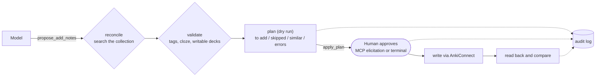

# anki-librarian-mcp

An MCP server that lets a model (Claude Code, Claude Desktop, any MCP client) work with your Anki collection
through **a locked door**: reads are free, and every write is a dry-run plan that a human approves before
anything reaches Anki. It is the public version of the flashcard librarian I run daily in my own agent system,
and an extended take on [Clanki](https://github.com/jasperket/clanki).

Why: years of review history are the asset. A model that can add, edit and delete notes in bulk will, sooner
or later, create duplicates, invent tags, or touch something it should not. Here the server, not the prompt,
enforces the rules.

## How a write works



1. **Propose.** Every write tool (`propose_*`) returns a plan and writes nothing. Before building it the server
   searches the collection: an exact duplicate is skipped, "same front, different back" is left for the human,
   and a front that is merely similar (default 85%) is flagged in the preview. Tags are checked against your
   taxonomy, cloze syntax against the whole batch, and every target deck against the writable list. A plan
   with errors is `invalid` and cannot be approved.
2. **Approve.** `apply_plan` on a pending plan asks the **human** through an MCP elicitation form (the client
   shows it; the model cannot answer it). If the client cannot show forms, the human approves in a terminal:
   `anki-librarian-mcp approve <plan>`, which refuses to run without an interactive terminal and requires the
   plan id to be typed. Plans expire after 15 minutes.
3. **Apply and verify.** The steps run, then the server reads the collection back and reports what was
   created and anything that does not match the plan. An edit whose note changed in Anki after the preview is
   refused (no stale writes).

Everything (proposed, approved, rejected, applied, failed, blocked) goes to an append-only audit log.

## Clanki × anki-librarian-mcp

| | Clanki | anki-librarian-mcp |
|---|---|---|
| Language | TypeScript (Node) | Python 3.11+ |
| Create deck, basic card, cloze card | yes | yes (`propose_create_deck`, `propose_add_notes`, `propose_add_cloze_notes`) |
| Bulk creation | yes (separate bulk tools) | yes (every add tool takes 1-50 notes) |
| Edit a note | yes | yes, with a before/after diff and stale-write protection |
| Search | yes (`find-cards`) | yes (`find_notes`, `get_notes`, with decks and tags) |
| Delete | yes, with `confirm: true`, max 50 | **off by default**; when switched on: plan + human approval, max 50, no delete-by-query |
| Reschedule (set due date) | no | **off by default**; same plan + approval when switched on |
| Dry run before writing | no | **every write** is a plan first |
| Who approves | the model sets `confirm: true` | **the human**, via MCP elicitation or an interactive terminal |
| Duplicate handling | Anki's own check on add | **reconciliation before creating**: duplicates skipped, conflicts left to the human, similar fronts flagged |
| Writable scope | whole collection | **allowlist of decks** (glob patterns); everything else is read-only |
| Tag rules | free text | **taxonomy check** (allowed roots, depth, naming), with suggestions |
| Forbidden actions | - | sync, package import, answering/resetting cards, deleting decks, mass tag rewrites: never; unknown actions blocked |
| Human flags | - | the red flag is the human's; the agent only sets/clears its own color and never overwrites another |
| Audit log | - | append-only JSON lines |
| Retries | - | reads retried with backoff; writes never retried (no duplicate writes on timeout) |
| Tests | - | 43 tests with a fake AnkiConnect (in-process and over HTTP) + an end-to-end MCP session over stdio |

Media (images and audio on cards) is not supported yet; Clanki has it.

## Install

Requires Anki desktop with the [AnkiConnect](https://ankiweb.net/shared/info/2055492159) add-on.

```
pip install git+https://github.com/gcabralcavalcanti/anki-librarian-mcp
cp anki-librarian.example.toml anki-librarian.toml     # then list your writable decks and taxonomy
anki-librarian-mcp check                                 # shows the settings and pings AnkiConnect
```

Claude Code:
```
claude mcp add anki -- anki-librarian-mcp --config /path/to/anki-librarian.toml serve
```
Claude Desktop (`claude_desktop_config.json`):
```json
{"mcpServers": {"anki": {"command": "anki-librarian-mcp", "args": ["--config", "/path/to/anki-librarian.toml", "serve"]}}}
```

## Tools

| Tool | Writes? | What it does |
|---|---|---|
| `list_decks` | no | all decks, and which are writable |
| `find_notes(query, limit)` | no | Anki search syntax; ids, model, decks, tags, field excerpts |
| `get_notes(note_ids)` | no | full fields and tags |
| `propose_add_notes(deck, notes)` | plan | basic notes, 1-50, reconciled and validated |
| `propose_add_cloze_notes(deck, notes)` | plan | cloze notes, 1-50 |
| `propose_update_note(note_id, fields, tags)` | plan | diff before/after |
| `propose_create_deck(name)` | plan | inside the writable decks |
| `propose_flag_cards(card_ids, color)` | plan | agent colors only; human flags skipped |
| `propose_delete_notes(note_ids)` | plan | only if `allow_delete = true` |
| `propose_set_due_date(card_ids, days)` | plan | only if `allow_reschedule = true` |
| `apply_plan(plan_id)` | **yes** | asks the human if pending; writes; reads back |
| `list_plans(status)` · `reject_plan(plan_id)` | no | plan housekeeping |

Human side (terminal): `anki-librarian-mcp plans | show <id> | approve <id> | reject <id> | audit`.

## Configuration

See [`anki-librarian.example.toml`](anki-librarian.example.toml). Every default is the safe one: no writable
deck until you list one, delete and reschedule off, approval by the human.

## Demo and tests

```
pip install -e ".[test]"
python -m pytest                      # 43 tests, fake AnkiConnect, no Anki needed
python examples/demo_session.py       # real server process over stdio + fake Anki over HTTP
```

[`examples/demo_transcript.md`](examples/demo_transcript.md) is the output of the demo: a search, a plan that is
invalid because of a tag, the corrected plan (one duplicate skipped, one similar front flagged), the approval
form the human sees, the write and its verification, a blocked delete, and the audit log.

## Design notes

- **The server enforces, the prompt only explains.** The tool descriptions tell the model the rules, but the
  lock in `connect.py` classifies every AnkiConnect action before a request is sent, and an unknown action is
  blocked by default.
- **Code first, model second.** Reconciliation, taxonomy, scope and cloze checks are deterministic. The model
  decides what to write; the server decides whether it may.
- **Generator is not approver.** The model can propose and apply, but approval comes from a channel it cannot
  speak on (an elicitation form, or a person typing in a terminal).

## License

MIT - Guilherme Cabral.
