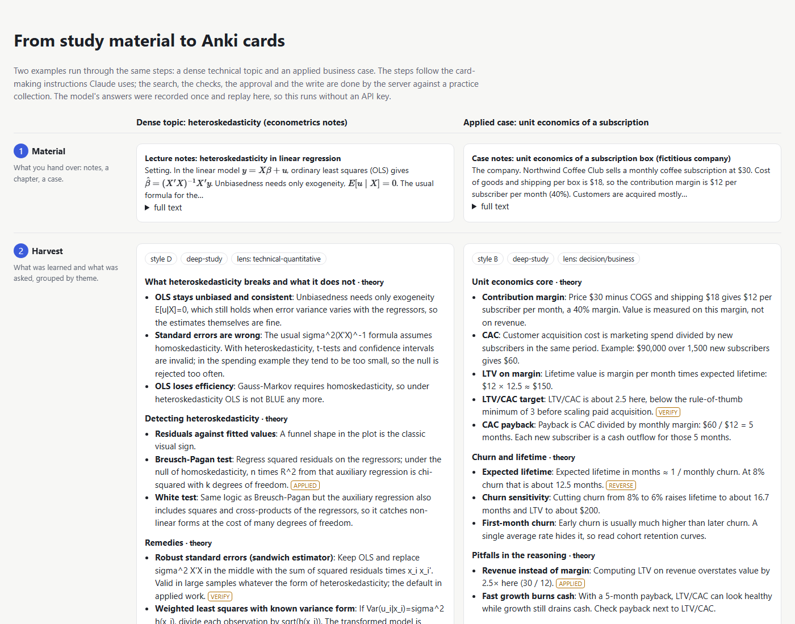
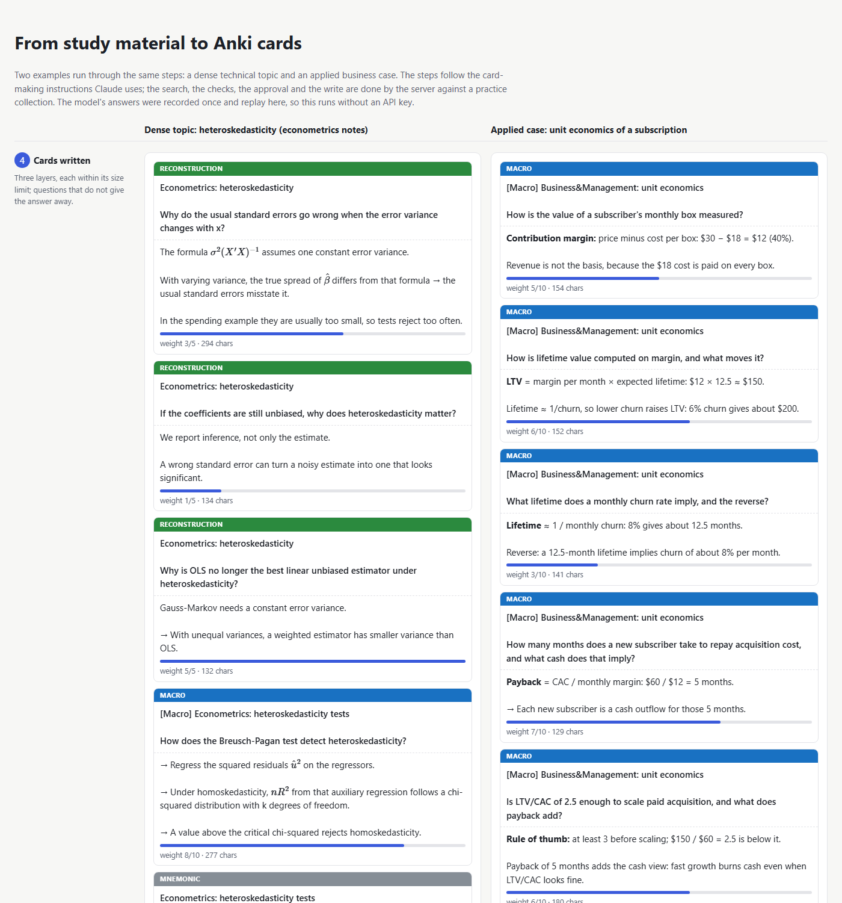
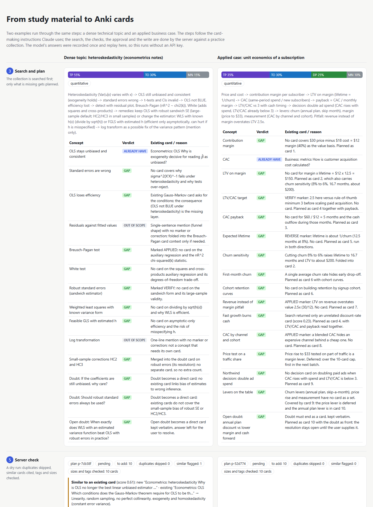

# How it works

The detail behind the README: what the server does at each step, how to install and use it, the safety rules, the
data and how to start on your own collection. Operations and troubleshooting are in [`RUNBOOK.md`](../RUNBOOK.md).

## What it does

- **From material to cards in one request.** "Make cards from these notes" runs five steps: a debrief of what was
  learned, a plan, a search of your collection, the cards themselves, and tags. See both examples in
  [`output/simulation.html`](../output/simulation.html).
- **No duplicates.** Before creating anything it searches your whole collection, by keyword and by similarity of
  the whole text, and shows you the existing card it found (the econometrics example found a card on the same
  theorem).
- **Cards that stay easy to review.** Each card has a size limit for its type, and questions that would give
  away their answer are refused.
- **Nothing is written without you.** Every change is shown first as a plan; you approve it in a form inside
  Claude Desktop or Claude Code, or in a terminal. Deleting and rescheduling are off unless you turn them on.



## Try the demo

```
pip install -r requirements.txt
python demo.py
```

Runs without an API key, replaying recorded answers. Set `ANTHROPIC_API_KEY` and add `--live` to call Claude live.
It uses a practice collection (your Anki is not touched) and opens a page with every step for two examples: dense
econometrics notes and a business case. It also starts the real server the way Claude Desktop does and records one
session in [`output/demo_transcript.md`](../output/demo_transcript.md).

## What you need

- **Anki** (desktop) with the **AnkiConnect** add-on, which lets programs on your computer talk to Anki. In Anki:
  Tools › Add-ons › Get Add-ons, code `2055492159`, then restart Anki.
- **Claude Desktop** or **Claude Code**.
- **Python 3.11** or newer.

## Install

```
pip install git+https://github.com/gcabralcavalcanti/anki-librarian-mcp
curl -O https://raw.githubusercontent.com/gcabralcavalcanti/anki-librarian-mcp/main/anki-librarian.example.toml
anki-librarian-mcp --config anki-librarian.example.toml check
```

Then rename the settings file to `anki-librarian.toml`, list the decks it may write to, and connect it:
- **Claude Code:** `claude mcp add anki -- anki-librarian-mcp --config /path/to/anki-librarian.toml serve`
- **Claude Desktop:** Settings › Developer › Edit Config, and add the entry from
  [`docs/config/claude_desktop_config.json`](config/claude_desktop_config.json).

## Use it

Open Claude, paste your material and say **"make cards from this"** (or pick the *Make cards from material*
prompt). What happens:

1. **Debrief.** Claude groups what the material teaches by theme and lists the questions that came up.
2. **Plan and search.** It searches your collection for each concept: what you already have is listed with the
   card it found; only what is missing is planned. You can move items before it continues.
3. **Cards.** Three kinds: a map of how the parts relate, a mechanism card, and short cards with one link or one
   fact. Math is written so Anki renders it.
4. **Tags.** Library-style tags from a taxonomy you can edit
   ([`skills/taxonomy.md`](../anki_librarian_mcp/skills/taxonomy.md)).
5. **Check.** The server runs a dry run: duplicates skipped, similar cards shown side by side, sizes and tags
   checked. Anything out of bounds comes back with the reason.
6. **Approval.** You see the cards that would be added and click approve (or reject).
7. **Written.** Cards go into Anki, are read back and compared with the plan; large cards get a blue flag so they
   are easy to find later.





Other things you can ask: "find my cards on inflation", "fix the tags of these cards", "add a picture of a
mitochondrion to this card" (it searches freely licensed images and adds the credit line), "this week's radar on
finance".

## What it never does

- Write, edit or move anything before you approve the plan.
- Delete cards or change their review schedule, unless you turn that on in the settings (and even then, with your
  approval each time).
- Sync, import packages, reset or answer cards, or delete decks.
- Write outside the decks you listed, or overwrite the red flag you use to mark wrong cards.

## The parts

| Part | What it is |
|---|---|
| [`anki_librarian_mcp/skills/`](../anki_librarian_mcp/skills/) | the instructions Claude follows at each step (debrief, plan, write, tag, weekly radar); also offered as prompts in Claude Desktop |
| `service.py` | every action as a plan first: search, checks, approval, write, read-back |
| `retrieval.py` | the search by similarity: a list of the words and phrases in every note of your collection, weighted by how rare they are, updated only where notes changed |
| `cards.py` | card types, size limits, the check against questions that give the answer away |
| `connect.py` | the only door to Anki: blocks forbidden actions before any request leaves |
| `media.py` | free-image search and pictures on cards |

Settings, with the safe default for each: [`anki-librarian.example.toml`](../anki-librarian.example.toml).

## Data

The demo uses a small practice collection ([`data/collection.json`](../data/collection.json)) and two pieces of
material written for it ([`data/materials/`](../data/materials/)); the company in the business case is fictitious. The
model's answers for the demo are stored in [`data/recorded/`](../data/recorded/). Nothing from a real collection is in
this repository.

## Limits

- Pictures only (no audio or video).
- "Similar" is measured by shared words and phrases across the whole collection; a card on the same idea in
  completely different words can be missed.
- The approval form depends on the app; when it cannot show one, approval moves to the terminal.
- Tested against a practice collection that behaves like Anki; try it on a test deck of your own first.

## Using it with your own collection

1. **Make a test deck first.** In Anki, create a deck such as `Inbox::Test` and copy a few cards into it.
2. **Install and check** (section Install above). `check` must say it reached Anki; if not, open Anki and see that
   AnkiConnect is installed.
3. **Say where it may write.** In `anki-librarian.toml`, set `writable_decks = ["Inbox::Test"]`. Every other deck
   stays read-only: it is searched for duplicates, never changed.
4. **Set your tag roots.** Under `[taxonomy]`, list the top levels you already use (or set `required = false` to
   skip the tag check while you try it).
5. **Connect it to Claude** (section Install) and ask for cards from a short text. Approve the first plan, open the
   deck in Anki and compare. When it behaves the way you want, add your real decks to `writable_decks`.

Approvals and the record of every action stay in the `.anki-librarian/` folder next to the settings.

**Study blocks on the calendar.** The other side of the flashcards, how many cards fall due in each deck and where
that time goes in the week, is in [personal-ai-agents](https://github.com/gcabralcavalcanti/personal-ai-agents):
`python demo.py study` turns the review forecast into study blocks for the task manager, checked by the same kind of
gate.
